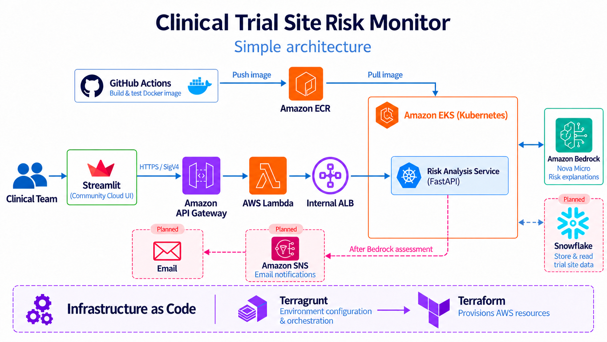

# Clinical Trial Site Risk Monitor

Clinical trial site risk monitoring platform using AWS, Kubernetes, Snowflake, Terraform, Terragrunt, and AI-driven risk analysis.

## Development Setup

See the [development setup guide](docs/setup.md) for installation and verification instructions, starting with Terraform on Windows.

## CI/CD

GitHub Actions runs checks on pull requests and produces a development deployment plan on `main`. An explicit manual workflow run deploys the Lambda through Terragrunt and Terraform, using OIDC authentication and S3 state locking. See the [CI/CD guide](docs/cicd.md) for workflow behavior and AWS permissions.

## API

The development HTTP API provides authenticated `GET /health` and `POST /site-assessments` routes. Site submissions support validation only; storage and risk analysis will be added later. See the [API guide](docs/api.md) for the contract, authentication, and example data.

## Problem Statement

Clinical trials are often conducted across multiple hospitals, clinics, and research sites. Each site is expected to meet operational targets such as patient enrollment goals, study timelines, protocol compliance, and timely issue resolution.

Some sites may begin falling behind without the problem being immediately obvious. Slow enrollment, repeated delays, patient dropouts, protocol deviations, or unresolved operational issues can eventually affect the overall clinical trial timeline and increase cost.

### Example

Suppose a clinical trial site is expected to enroll **60 patients**, but it has enrolled only **21 patients**. The site is also **18 days behind schedule** and has **3 unresolved operational issues**.

This site may represent a higher operational risk and should receive attention before the problems become more serious.

## What We Are Trying to Solve

The goal of this project is to provide a simple **Clinical Trial Site Risk Monitor** that helps clinical operations teams quickly identify:

- which trial sites are performing normally
- which sites are beginning to fall behind
- which sites may represent a high risk
- the main reasons a site has been classified as risky

The application provides an easy way to review trial-site performance and detect potential problems earlier, helping teams focus attention on the sites that need it most.

## Architecture

Terragrunt manages environment configuration and orchestrates Terraform, which provisions the AWS infrastructure shown above.

## Things to Do

The Lambda and authenticated API Gateway are deployed. Site submissions currently support validation only; the following work remains:

- [ ] Define and document Low, Medium, and High risk rules and the reasons for each classification.
- [ ] Build and test the FastAPI risk service locally using representative site data.
- [ ] Provision EKS, networking, and load balancing through Terraform and Terragrunt.
- [ ] Deploy the risk service and connect Lambda to it.
- [ ] Add Snowflake storage for trial-site data and assessment results.
- [ ] Build the Streamlit interface for data uploads, site summaries, and risk results.
- [ ] Provision Streamlit hosting and its scoped API access through Terraform and Terragrunt.
- [ ] Add Amazon Bedrock explanations based on calculated risk results.
- [ ] Extend CI/CD to deploy and verify the remaining application components.
- [ ] Add monitoring, alerts, and end-to-end tests for the complete workflow.
- [ ] Update the architecture diagram to show CI/CD, S3 state, CloudWatch logs, API security, and implemented versus planned components.

## Documentation

### Development Setup

[Read the setup guide](docs/setup.md) for tool installation, local testing, and Terraform/Terragrunt configuration.

### API Guide

[Read the API guide](docs/api.md) for endpoints, authentication, submission fields, and request examples.

### CI/CD and Deployment

[Read the CI/CD guide](docs/cicd.md) for GitHub Actions workflows, AWS access, deployment approval, and verification.
